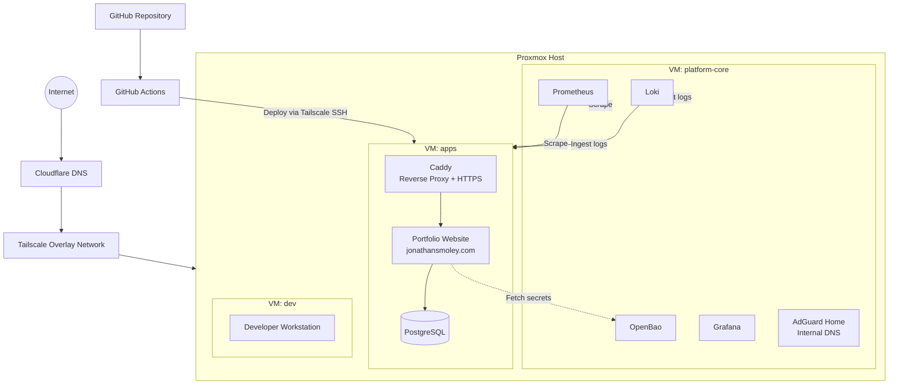

# High-Level Architecture

## Notes

- `platform-core` hosts the control-plane and observability stack (OpenBao, Grafana, Prometheus, Loki, AdGuard Home).
- `apps` hosts the reverse proxy, database, and the portfolio website.
- `dev` is a full developer workstation joined to the same Tailscale network.
- All management traffic (SSH, OpenBao UI, Grafana, etc.) travels over Tailscale.
- Public HTTPS traffic for the portfolio site is terminated by Caddy after DNS resolution via Cloudflare.
- The portfolio site is the primary workload that proves the platform; it will evolve from the current static Cloudflare Worker into a dynamic application backed by PostgreSQL and additional APIs.
