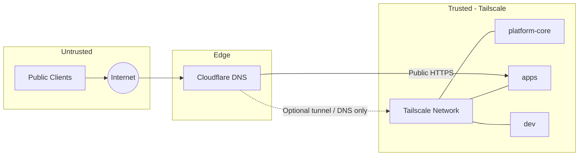
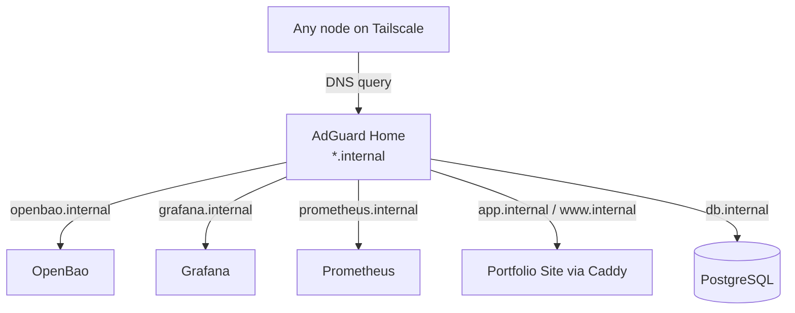
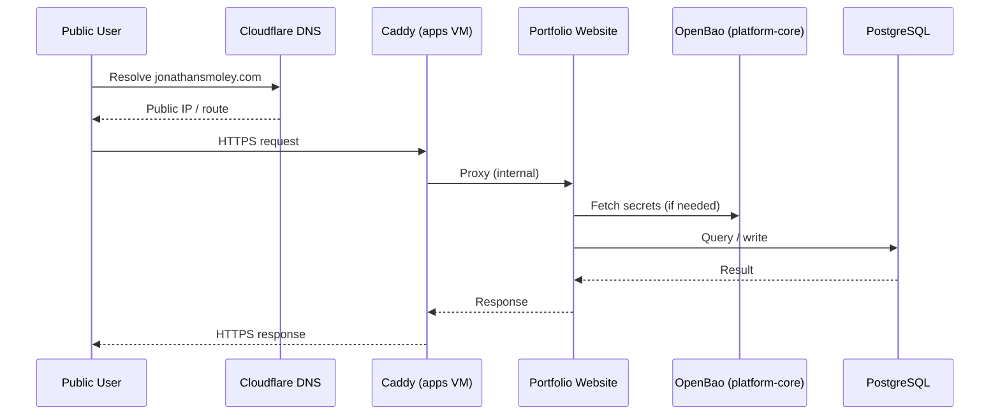
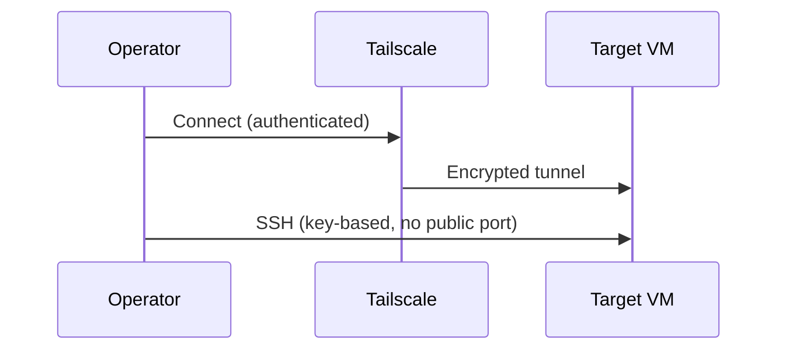

# Networking & Traffic Flows

## Overlay and Trust Zones

## Internal DNS & Service Discovery

## Public Request Path (Portfolio Site)

## Management / SSH Path

## Notes

- No SSH (or other admin ports) are exposed to the public internet.
- Tailscale ACLs can be tightened later to further restrict which nodes can reach which services.
- Internal DNS removes the need to hard-code IP addresses in configuration.
- The portfolio site (`jonathansmoley.com`) is the primary public-facing application.
