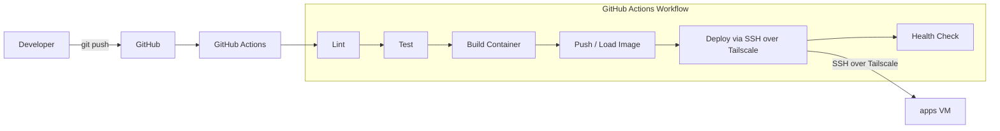
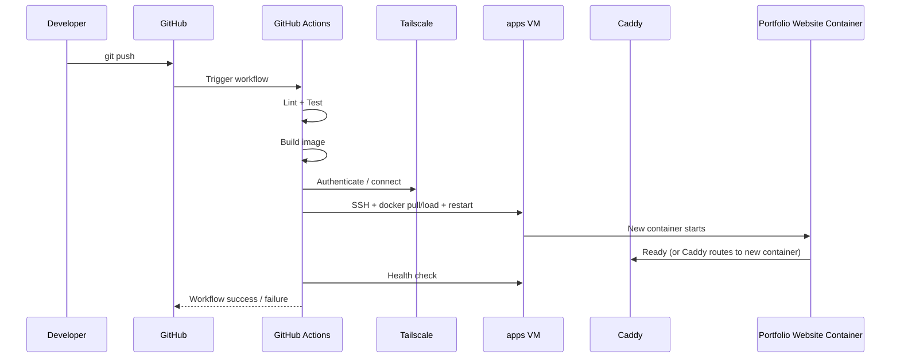
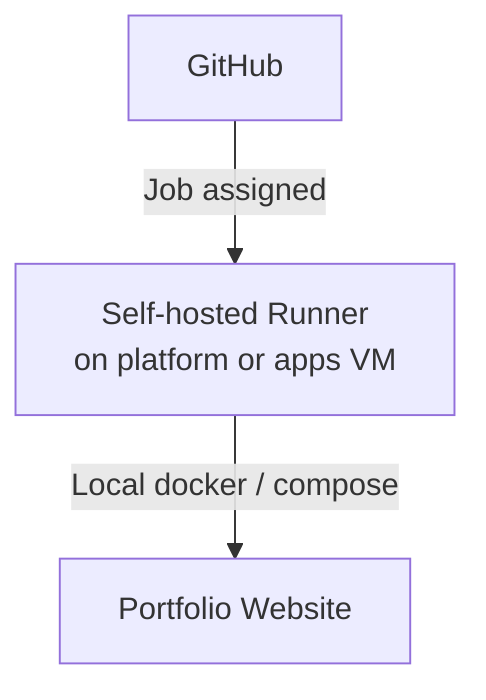

# Deployment & CI/CD Flow

## Pipeline Overview

## Detailed Deployment Sequence (SSH-over-Tailscale – MVP path)

## Alternative: Self-Hosted Runner (Future / Optional)

## Notes

- **MVP decision:** GitHub-hosted runners + SSH over Tailscale.
- Secrets required by the pipeline (deploy keys, registry creds, etc.) should come from GitHub Secrets or, better, be fetched via OpenBao where practical.
- Rollback = redeploy previous known-good image tag + documented procedure in runbooks.
- The portfolio site migration from the current Cloudflare Worker will have its own cut-over and rollback plan.
