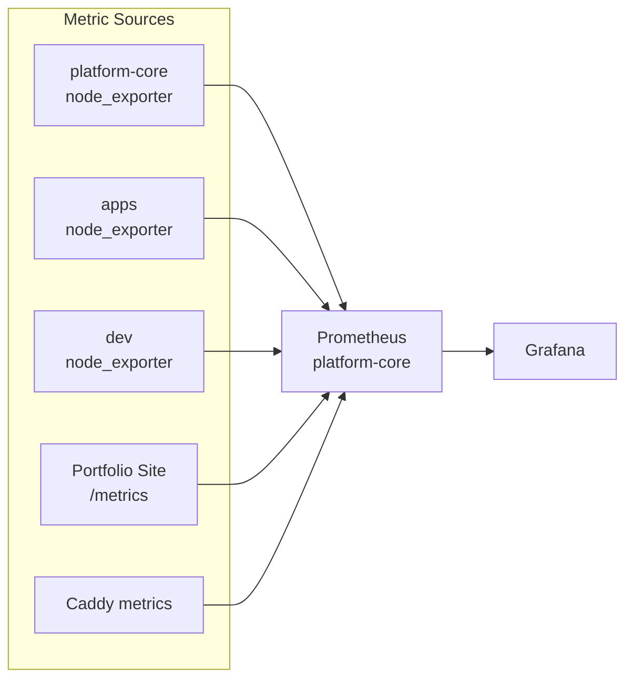
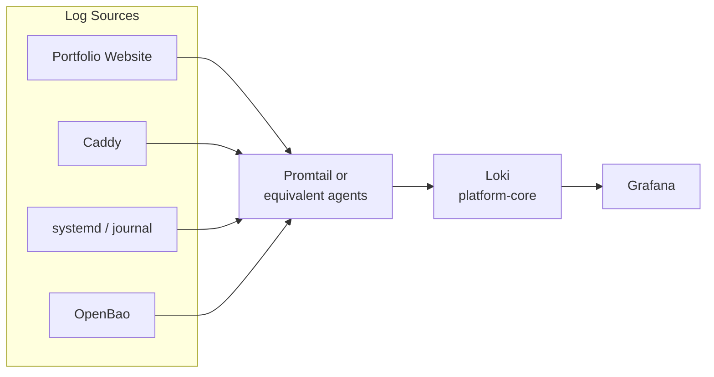
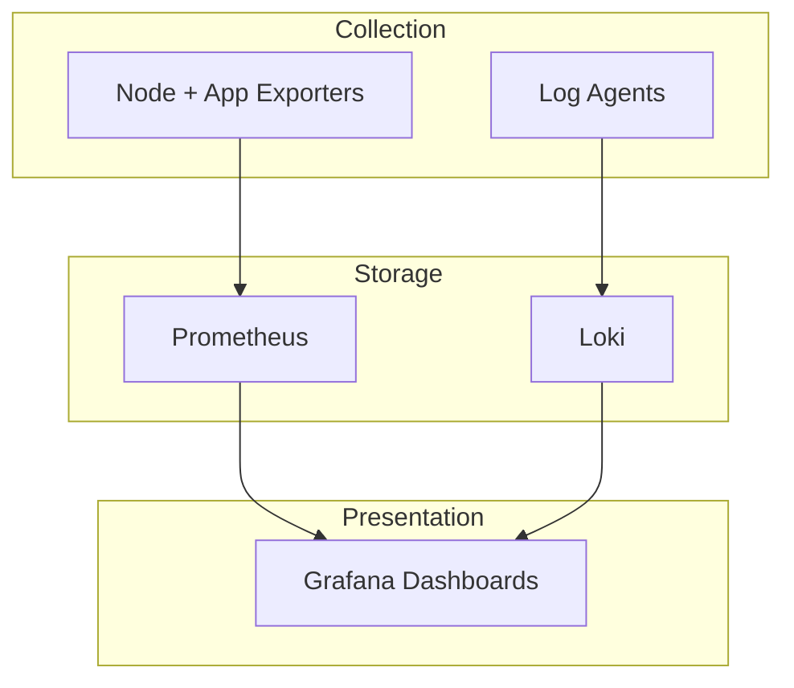

# Observability Data Flow

## Metrics Path

## Logging Path

## End-to-End Observability View

## Required Dashboards (MVP)

1. **Infrastructure Health** – host + all VMs (CPU, memory, disk, network)
2. **VM / Node Detail** – per-VM drill-down
3. **Application** – request rate, latency, errors, saturation for the portfolio site

## Notes

- All observability components live on `platform-core` to keep the data plane separate from the control/observability plane where practical.
- Grafana is the single pane of glass for both metrics and logs in the MVP.
- The portfolio site should expose Prometheus metrics and structured logs from the first dynamic version.
