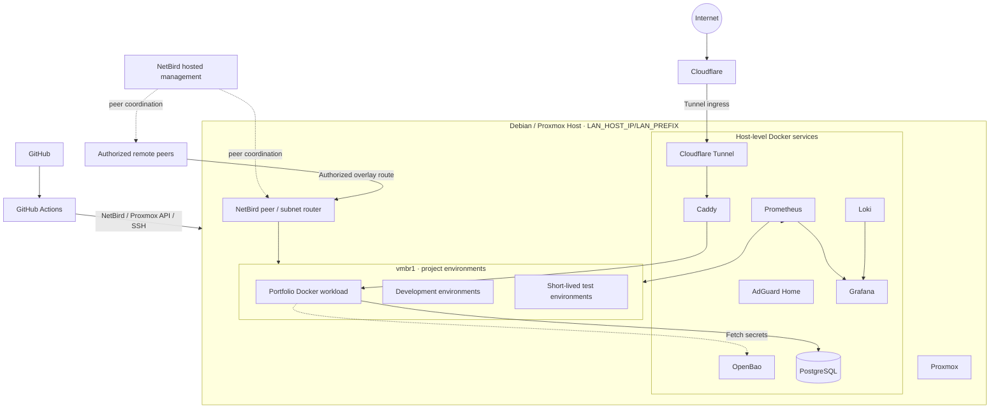

# High-Level Architecture

## Notes

- Core services run as Docker containers on the Debian host OS, separate from
  Proxmox-managed guests.
- NetBird uses hosted management. The Debian host runs the peer and advertises
  the authorized project subnet; remote peers access only what policy permits.
- Proxmox is the quick-provisioning environment for project, development, and
  test workloads. The portfolio is a project workload.
- Use Proxmox VMs for Docker-based project workloads; do not nest Docker inside
  an LXC.
- AdGuard Home provides internal DNS. Caddy handles internal routing and
  receives public requests from the host's Cloudflare Tunnel.
- The host firewall blocks local-LAN-initiated access to platform services and
  the project subnet, except DNS to AdGuard Home on TCP/UDP 53.
- No public ports are opened on the host.
