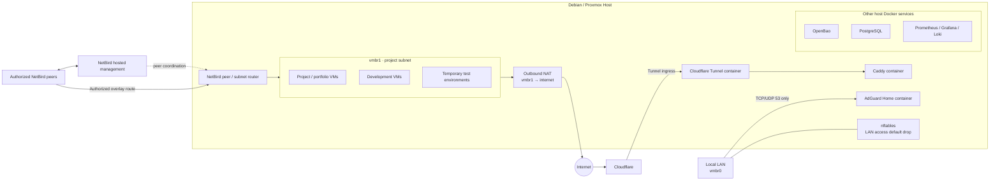
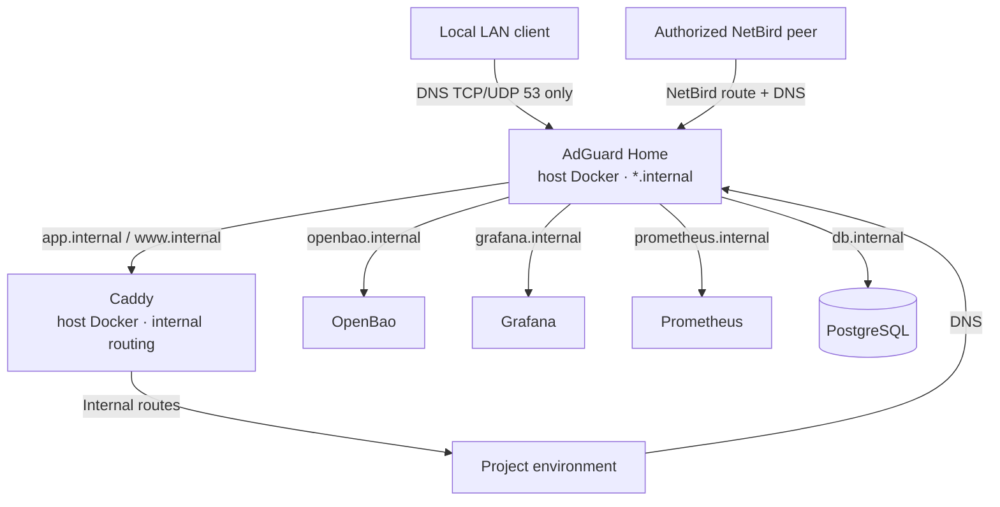
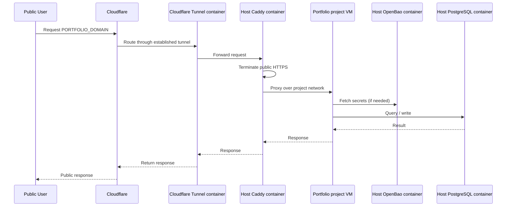
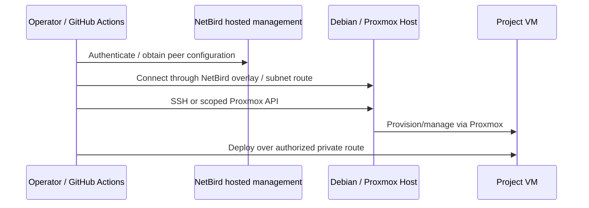

# Networking & Traffic Flows

## Interfaces and Trust Zones

- The Debian/Proxmox host uses `vmbr0` for the local LAN. Its address is
  deployment-specific (`<LAN_HOST_IP>/<LAN_PREFIX>`).
- Proxmox guests use the dedicated `vmbr1` project subnet. Its CIDR, gateway,
  and guest addresses are deployment-specific (`<PROJECT_SUBNET>`).
- Host `nftables` defaults to drop for local-LAN-initiated access to host
  services and `vmbr1`. The only exception is TCP/UDP port 53 from the LAN to
  AdGuard Home.
- Host NAT allows project guests to make outbound internet connections for
  package and image downloads; it does not allow LAN-initiated access.
- The Debian host runs a NetBird peer using NetBird-hosted management and
  advertises the project subnet. NetBird policies restrict which peers can
  reach the host and guest addresses.
- No public SSH or other host ports are exposed.

## Internal DNS and Routing

AdGuard Home resolves internal names for local DNS clients, authorized
NetBird peers, and project environments. LAN clients may query DNS but cannot
initiate connections to other host services or project guests. Caddy provides
internal service routing; PostgreSQL should only be reachable by authorized
clients.

## Public Request Path

The Tunnel originates from the host and forwards requests to Caddy. Caddy
routes the portfolio request to its Proxmox project environment. No public
ports are opened on the host.

## Management and Deployment Path

## Notes

- NetBird replaces Tailscale for private remote access and subnet routing.
- NetBird management is hosted; no self-hosted NetBird control-plane service is
  planned.
- Local LAN access to platform services is limited to DNS queries to AdGuard
  Home; public access is through Cloudflare Tunnel and Caddy.
