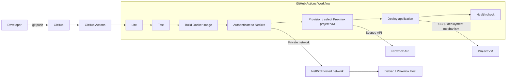
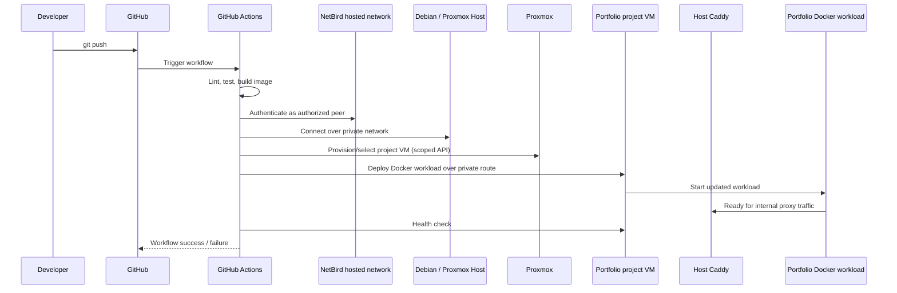

# Deployment & CI/CD Flow

## Pipeline Overview

## Portfolio Deployment Sequence

## Notes

- Core services are Docker containers on the Debian host OS; project workloads
  run in Proxmox-managed environments.
- Use VMs for Docker-based project workloads rather than nesting Docker inside
  LXCs.
- GitHub Actions uses NetBird for private connectivity and narrowly scoped
  Proxmox/deployment credentials.
- Proxmox provides quick provisioning for projects, development, and tests;
  persistent project data must be backed up separately from disposable
  environments.
- The portfolio cut-over from its Cloudflare Worker has a separate rollback
  procedure.
