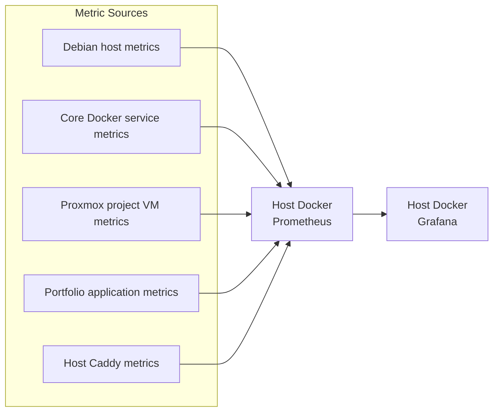
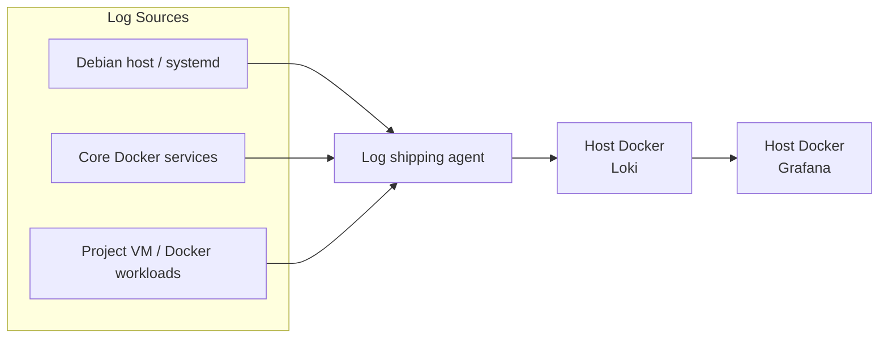
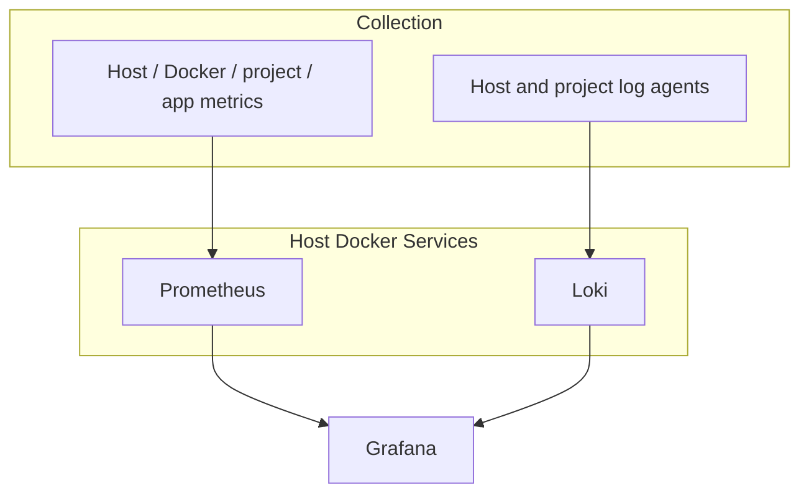

# Observability Data Flow

## Metrics Path

## Logging Path

## End-to-End Observability View

## Required Dashboards (MVP)

1. **Infrastructure Health** – Debian host, Docker core services, and Proxmox
   project environments
2. **Project Environment Detail** – per-VM and workload drill-down
3. **Application** – portfolio request rate, latency, errors, and saturation

## Notes

- Prometheus, Grafana, and Loki run as Docker containers on the Debian host OS.
- Collect metrics and logs from the host, core Docker services, and project
  workloads.
- Grafana is the single pane of glass for metrics and logs.
- Avoid collecting secrets or sensitive payloads in logs.
