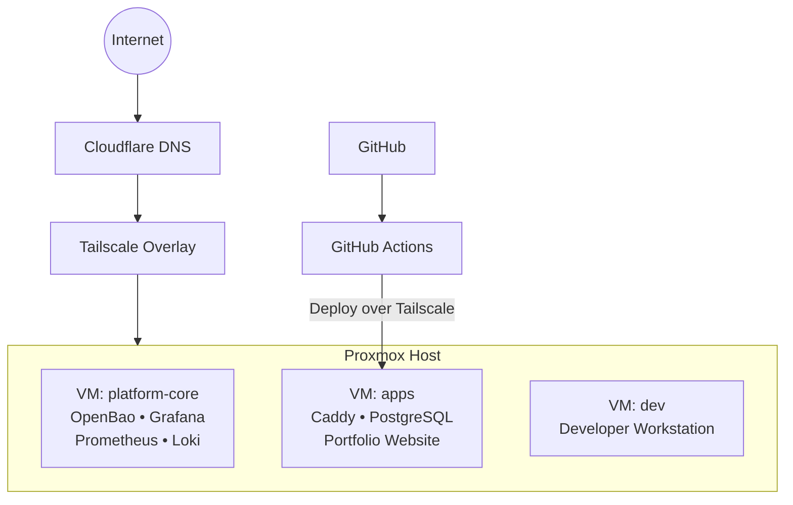

# Technical Design Document

**Project:** Self-Hosted Developer Platform (30-Day MVP)  
**Status:** Planning / Draft  
**Last Updated:** 2026-11-09

---

## Documentation Principles

- Prefer written runbooks and design decisions over tribal knowledge.
- Every service must have a documented recovery path.
- Diagrams live as Mermaid (or draw.io source) in version control so they stay accurate.
- Documentation is updated continuously as decisions are made, not deferred to Week 4.
- The design document and runbooks are first-class deliverables equal in importance to the running system.

---

## 1. Overview

### Purpose

Build a self-hosted developer platform on Proxmox that provides a production-like environment for developing, deploying, monitoring, and operating software projects.

The platform serves two purposes:

1. Enable rapid development of future personal projects.
2. Demonstrate platform engineering, infrastructure, and software delivery skills to employers.

### Narrative

Instead of “I built a homelab,” the goal is to demonstrate:

> “I designed and operated a secure self-hosted developer platform that supports application development, deployment, observability, secrets management, and remote administration.”

### Primary Application

The workload that proves the platform is the portfolio website currently living at [https://jonathansmoley.com](https://jonathansmoley.com) (static site on a Cloudflare Worker).

**Migration goal:** move it onto the self-hosted platform so it can become dynamic, use the platform’s PostgreSQL instance, and expose or consume additional APIs beyond a networked database.

### Scope (MVP)

In scope:

- Secure remote access (Tailscale)
- Centralized secrets management (OpenBao)
- Internal DNS (AdGuard Home)
- Reverse proxy with HTTPS (Caddy)
- Containerized deployment of the portfolio website
- CI/CD automation (GitHub Actions)
- Metrics collection (Prometheus)
- Centralized logging (Loki)
- Documentation and operational runbooks

Out of scope for this 30-day MVP (see also section 11):

- Kubernetes / Nomad / Consul / service mesh
- Terraform / IaC beyond basic scripting
- High availability / multi-node clusters
- Complex authentication / multi-tenancy
- AI agents or heavy frontend work beyond what the portfolio needs

---

## 2. Requirements

### Functional Requirements

| ID | Requirement | Priority |
|----|-------------|----------|
| FR-1 | Secure remote administration of all VMs without public SSH exposure | Must |
| FR-2 | Centralized secret storage and retrieval for applications and CI | Must |
| FR-3 | Internal DNS resolution for platform services | Must |
| FR-4 | HTTPS termination and reverse proxy for public-facing and internal services | Must |
| FR-5 | Automated build, test, and deployment of the containerized portfolio website | Must |
| FR-6 | Collection and visualization of infrastructure and application metrics | Must |
| FR-7 | Centralized aggregation of application and infrastructure logs | Must |
| FR-8 | Documented procedures for common operational tasks | Must |
| FR-9 | Persistent storage for the portfolio site (PostgreSQL) | Must |
| FR-10 | Portfolio site can read/write PostgreSQL and call additional internal/external APIs | Should |

### Non-Functional Requirements

| ID | Requirement | Notes |
|----|-------------|-------|
| NFR-1 | All management traffic travels over Tailscale | No public ports for SSH/admin |
| NFR-2 | Secrets never committed to Git or stored in plain text on disk | OpenBao is source of truth |
| NFR-3 | Platform services restart automatically after reboot | systemd / container restart policies |
| NFR-4 | Documentation must be sufficient for a new engineer (or future self) to operate the platform | Runbooks + design doc |
| NFR-5 | MVP must be achievable in ≤ 30 days by a single person | Aggressive prioritization |

### Constraints

- Single Proxmox host (no clustering in MVP)
- Limited hardware resources (to be measured and recorded)
- Public domain (`jonathansmoley.com`) and Cloudflare account available
- GitHub account for source control and Actions
- Current portfolio is a static Cloudflare Worker; migration path must be deliberate

---

## 3. System Architecture

### High-Level Overview



### Component Responsibilities

| Component | Location | Primary Responsibilities |
|-----------|----------|--------------------------|
| Proxmox | Host | Virtualization, VM lifecycle, snapshots, backups |
| Tailscale | All VMs + host | Secure remote access, private networking |
| AdGuard Home | platform-core or apps | Internal DNS, service discovery |
| OpenBao | platform-core | Secrets storage and dynamic credentials (Vault-compatible) |
| Caddy | apps | Reverse proxy, automatic HTTPS |
| PostgreSQL | apps | Persistent storage for the portfolio website |
| Prometheus | platform-core | Metrics scraping and storage |
| Grafana | platform-core | Dashboards and visualization |
| Loki | platform-core | Log aggregation |
| Portfolio Website | apps | Primary workload; proves the platform end-to-end |
| GitHub Actions | External | CI/CD pipeline |

### Architecture Diagrams

Detailed diagrams are maintained in `docs/architecture/`:

- [High-level topology](architecture/01-high-level.md)
- [Networking & traffic flows](architecture/02-networking.md)
- [Deployment & CI/CD flow](architecture/03-deployment.md)
- [Observability data flow](architecture/04-observability.md)

---

## 4. Networking

### Overlay Network

- Tailscale provides the primary management and inter-service network.
- No public SSH ports are exposed on any VM.
- Public HTTPS is terminated at Caddy (via Cloudflare DNS → public IP or tunnel if used).

### Internal DNS

- AdGuard Home serves `*.internal` (or chosen internal domain).
- Example records:
  - `openbao.internal`
  - `grafana.internal`
  - `prometheus.internal`
  - `app.internal` / `www.internal`
  - `db.internal`

### Public Exposure

- The portfolio site is published via Caddy under the existing domain (`jonathansmoley.com` and any subdomains needed).
- Only services intentionally published via Caddy receive public DNS records.
- All other access remains private via Tailscale.

### Traffic Flow Principles

1. Management / SSH → Tailscale only
2. Inter-VM service communication → Tailscale or internal bridge as appropriate
3. Public client → Cloudflare → Caddy → portfolio application
4. CI/CD runners → Tailscale SSH (primary path for MVP)

*(Detailed Mermaid diagrams live in `docs/architecture/02-networking.md`)*

---

## 5. Security Model

### Trust Boundaries

- **Internet** → untrusted
- **Cloudflare** → semi-trusted (DNS + optional proxy)
- **Tailscale network** → trusted management plane
- **Individual VMs** → least privilege between services
- **OpenBao** → root of trust for secrets

### Key Controls

| Control | Implementation |
|---------|----------------|
| Remote access | Tailscale + SSH key auth; no password auth; no public SSH |
| Secrets | OpenBao; applications fetch at runtime; short-lived where possible |
| Network segmentation | Separate VMs for platform-core vs apps; firewall rules as needed |
| TLS | Caddy automatic HTTPS for published services |
| Audit | OpenBao audit logs; system logs → Loki |
| Least privilege | Services run as non-root where practical; limited capabilities |

### Threat Model (MVP Level)

| Threat | Mitigation |
|--------|------------|
| Compromised public service | Caddy reverse proxy + minimal attack surface; no direct DB exposure |
| Stolen credentials | Secrets in OpenBao; rotation runbook; short-lived tokens preferred |
| Lateral movement | Separate VMs + Tailscale ACLs (to be refined) |
| Data loss | Proxmox backups + PostgreSQL backup strategy + documented restore |
| Insider / future-self mistakes | Runbooks + decision records |

A more formal threat model can be expanded post-MVP if needed.

---

## 6. Deployment Strategy

### Target

- Portfolio website and supporting services (Caddy, PostgreSQL) run on the `apps` VM.
- Platform services (OpenBao, monitoring, logging) run on `platform-core`.

### CI/CD Pipeline (GitHub Actions)

```text
Push / PR
  → Lint
  → Unit / integration tests
  → Build container image
  → Push image (or load on target)
  → Deploy via SSH over Tailscale
  → Health check / restart service
```

### Deployment Approach (Decided)

**Primary path for MVP: SSH over Tailscale from GitHub-hosted runners.**

Rationale:
- Fastest to implement
- No additional runner infrastructure to maintain during the 30-day window
- Still demonstrates secure, private deployment over the Tailscale mesh

**Future improvement (documented, not required for MVP):** self-hosted GitHub runner on the platform for tighter control and elimination of deploy-key exposure from external runners.

### Application Lifecycle

- Containerized (Docker or Podman)
- Configuration and secrets injected from OpenBao (or environment files populated from OpenBao)
- Restart / rollback procedures documented in runbooks
- Migration from the current Cloudflare Worker static site will be treated as a deliberate cut-over with a rollback plan

---

## 7. Observability

### Metrics (Prometheus)

- Node exporters on all VMs
- Container metrics where available
- Application-specific metrics (request rate, latency, error rate) from the portfolio site

### Visualization (Grafana)

Required dashboards:

1. Infrastructure Health (host + VMs)
2. VM / Node Metrics
3. Application Metrics (portfolio site)

### Logging (Loki)

- Application logs (portfolio site)
- Infrastructure / service logs
- Key operational events

### Principles

- Logs and metrics are treated as first-class outputs of the platform.
- Dashboards and log queries used in the demo video must be reproducible from the documentation.

---

## 8. Backup and Recovery

### Proxmox Level

- Regular VM backups (schedule to be defined)
- Snapshot strategy before major changes

### Application / Data Level

- PostgreSQL: logical backups (`pg_dump`) + documented restore procedure
- OpenBao: unseal / recovery keys stored securely offline; snapshot or backup of storage backend

### Recovery Objectives (MVP Targets)

- Ability to restore a single VM from backup
- Ability to restore the database to a known good state
- Ability to re-deploy the portfolio website from Git + container image

All procedures must have corresponding runbooks.

---

## 9. Tradeoffs

| Decision | Chosen Approach | Alternatives Considered | Rationale |
|----------|-----------------|-------------------------|-----------|
| Remote access | Tailscale | WireGuard, public SSH + fail2ban, Cloudflare Tunnel only | Simple, zero-config mesh, strong identity |
| Reverse proxy | Caddy | Traefik, Nginx | Automatic HTTPS, simple config |
| Secrets | **OpenBao** | HashiCorp Vault, Doppler, plain files + age, cloud secret managers | Vault-compatible API, fully open-source (MPL-2.0), Linux Foundation governance, no BUSL restrictions |
| Orchestration | Docker Compose / systemd | Kubernetes, Nomad | Fits 30-day scope; K8s is explicit non-goal |
| CI/CD | GitHub Actions + SSH-over-Tailscale | Self-hosted runner only, Drone, etc. | Zero extra infra for MVP; secure private path |
| DNS | AdGuard Home | CoreDNS, dnsmasq, systemd-resolved | Simple UI + filtering capability |
| Workload | Portfolio website (jonathansmoley.com) | Generic demo API / todo app | Real personal asset; forces dynamic + DB + API concerns; strong portfolio story |

Additional tradeoffs will be recorded as Architecture Decision Records in `docs/decisions/` when significant choices are finalized.

---

## 10. Operational Model

- Single operator (project owner)
- Changes follow: design note → implement → update runbook/design doc → verify
- Prefer immutable-ish deployments (rebuild container) over long-lived mutable servers where practical
- Every new service must answer: How is it monitored? How are secrets provided? How is it recovered?

---

## 11. Future Work (Post-MVP / v2)

Explicitly deferred:

- Kubernetes or Nomad
- Service mesh / Consul
- Full Terraform / declarative IaC
- High availability and multi-node
- OpenTelemetry distributed tracing
- More sophisticated authn/authz
- Multi-environment (dev/stage/prod) promotion flows
- Automated secret rotation beyond manual runbook
- Self-hosted GitHub runner as primary deploy path

These are intentionally out of scope so the 30-day MVP remains shippable and demonstrable.

---

## 12. Success Criteria & Definition of Done

The project is complete when:

- [ ] Infrastructure is stable and services run continuously
- [ ] Secrets are stored in and retrieved from OpenBao
- [ ] HTTPS is operational via Caddy
- [ ] Metrics appear in Grafana
- [ ] Logs appear in Loki
- [ ] GitHub Actions deploys the portfolio website automatically via SSH over Tailscale
- [ ] Portfolio website is reachable, functional, and using PostgreSQL (and any additional APIs)
- [ ] This design document is complete and accurate
- [ ] Core runbooks exist and have been tested
- [ ] Architecture diagrams are finished
- [ ] Demo video is recorded

At that point the project shifts from “building infrastructure” to “demonstrating engineering capability.”

---

## Appendix A – Related Documents

- `docs/architecture/` – diagrams
- `docs/runbooks/` – operational procedures
- `docs/decisions/` – Architecture Decision Records (to be populated)
- `docs/demo/demo-script.md` – video outline
- Project plan: `../project-plan.txt`
