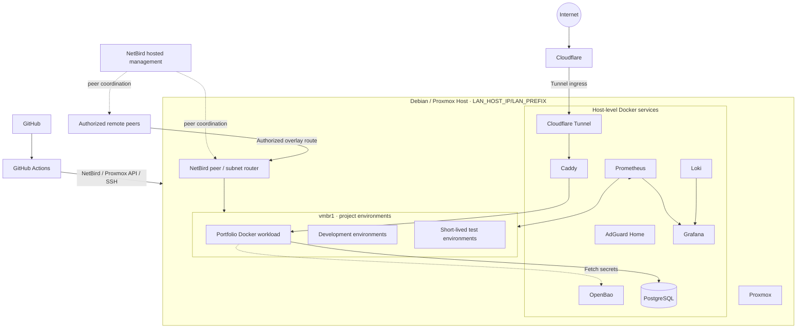

# Technical Design Document

**Project:** Self-Hosted Developer Platform
**Status:** Planning / Draft

---

## Documentation Principles

- Every service must have a documented recovery path.
- Diagrams live in version control and are updated with architecture changes.
- Keep operational runbooks and design documentation aligned with the running
  system.

## 1. Overview

### Purpose

Build a self-hosted developer platform on a Debian/Proxmox host. Core platform
services run as Docker containers on the Debian host OS, outside Proxmox guests.
Proxmox is the quick-provisioning environment for project, development, and
testing workloads.

### Primary Application

The portfolio website demonstrates the platform end-to-end. The target is a
dynamic application using host PostgreSQL and OpenBao, deployed as a Docker
workload in a Proxmox-managed project environment and published through Caddy
and Cloudflare Tunnel.

### Scope (MVP)

In scope:

- NetBird remote access and subnet routing
- Host-level Docker services: AdGuard Home, OpenBao, Caddy, PostgreSQL,
  Prometheus, Grafana, Loki, and Cloudflare Tunnel
- Proxmox project environments for development, testing, and project workloads
- Internal DNS and routing; Cloudflare Tunnel public ingress
- GitHub Actions CI/CD over NetBird
- Metrics, centralized logging, backup and recovery documentation

Out of scope:

- Kubernetes, Nomad, Consul, or service mesh
- High availability or multi-node clusters
- Full Terraform / declarative IaC
- Complex authentication or multi-tenancy

## 2. Requirements

### Functional Requirements

| ID | Requirement | Priority |
|----|-------------|----------|
| FR-1 | Secure remote administration of the Debian/Proxmox host and authorized project environments without public SSH | Must |
| FR-2 | Centralized secret storage and retrieval through OpenBao | Must |
| FR-3 | Internal DNS through AdGuard Home for core services and projects | Must |
| FR-4 | Internal routing through Caddy and public ingress through Cloudflare Tunnel | Must |
| FR-5 | Quickly provision isolated Proxmox environments for projects, development, and testing | Must |
| FR-6 | Build, test, and deploy the portfolio as a Docker workload in a project environment | Must |
| FR-7 | Collect and visualize host, Docker, project, and application metrics | Must |
| FR-8 | Aggregate platform and project logs | Must |
| FR-9 | Persist portfolio data in PostgreSQL | Must |
| FR-10 | Document and test backup, restore, and recovery procedures | Must |

### Non-Functional Requirements

| ID | Requirement | Notes |
|----|-------------|-------|
| NFR-1 | Management access uses NetBird; no public SSH | NetBird-hosted management/control plane |
| NFR-2 | Secrets are not committed to Git | OpenBao is the source of truth |
| NFR-3 | Services restart after host or guest reboot | Docker restart policy/systemd; guest startup policy |
| NFR-4 | Documentation is sufficient to operate and recover the platform | Design, diagrams, and runbooks |
| NFR-5 | Keep the MVP feasible for one operator | Prefer simple Docker-based deployment |

### Constraints

- Single Debian/Proxmox host
- Core Docker services share the physical host with Proxmox but run on its
  Debian host OS, not inside PVE-managed guests
- Limited hardware resources; measure and document them
- A public domain, Cloudflare account, and GitHub account are available
- The current portfolio is a static Cloudflare Worker; migration is deliberate

## 3. System Architecture



### Component Responsibilities

| Component | Location | Primary Responsibilities |
|-----------|----------|--------------------------|
| Debian / Proxmox | Single physical host | Host OS services and Proxmox project environment lifecycle |
| NetBird peer | Debian host | Private remote access and route advertisement for `vmbr1` |
| NetBird management | NetBird-hosted | Peer management and network coordination |
| AdGuard Home | Host Docker | Internal DNS; local LAN access limited to TCP/UDP 53 |
| OpenBao | Host Docker | Secret storage and credentials |
| Caddy | Host Docker | Internal routing and HTTPS termination |
| PostgreSQL | Host Docker | Shared database service with multiple databases/roles |
| Prometheus | Host Docker | Metrics collection and storage |
| Grafana | Host Docker | Dashboards and visualization |
| Loki | Host Docker | Log aggregation |
| Cloudflare Tunnel | Host Docker | Public ingress to Caddy without public host ports |
| Portfolio | Proxmox project environment | Docker workload demonstrating the platform |
| GitHub Actions | External | Build, test, and deployment automation |

The core services are host-level Docker containers, not Proxmox guests.
Proxmox-managed VMs are the default place for Docker-based project workloads;
LXCs may be used for quick environments that do not require a nested Docker
runtime.

Detailed diagrams live in `docs/architecture/`.

## 4. Networking

### Interfaces, Subnets, and Isolation

- `vmbr0` connects the Debian host to the local LAN over ethernet. Configure
  the host address as `<LAN_HOST_IP>/<LAN_PREFIX>`.
- `vmbr1` is reserved for Proxmox project environments. Its CIDR and host
  bridge address remain to be filled in.
- Host `nftables` defaults to drop for local-LAN-initiated access to host
  services and `vmbr1`. The sole LAN exception is TCP/UDP port 53 to AdGuard
  Home.
- Host firewall policy must account for Docker's networking and published-port
  rules so Docker does not unintentionally bypass the LAN isolation policy.
- Host NAT allows project environments on `vmbr1` to make outbound internet
  connections for package and image downloads.
- NetBird is installed on the Debian host and uses NetBird-hosted management.
  The host advertises the project subnet to authorized peers; the advertised
  subnet and guest addressing remain to be finalized.
- NetBird policies restrict remote peer access. No public SSH or management
  ports are exposed.

### Internal DNS and Routing

- AdGuard Home on the host resolves `*.internal` for local DNS clients,
  authorized NetBird peers, and project environments.
- Caddy on the host routes internal requests to host services and project
  workloads. Example names include `openbao.internal`, `grafana.internal`,
  `prometheus.internal`, `app.internal`, and `db.internal`.
- LAN clients can reach AdGuard only for DNS; they cannot initiate access to
  other host services or project environments.

### Public Exposure

- Cloudflare Tunnel runs as a Docker service on the Debian host and forwards
  public requests to Caddy. No public ports are opened on the host.
- Caddy terminates public HTTPS and routes the portfolio hostname to the
  portfolio workload in its Proxmox project environment.
- Other services remain private unless intentionally published through Caddy.

### Traffic Flow Principles

1. Local LAN → AdGuard: TCP/UDP 53 only.
2. Project environments → internet: outbound through host NAT.
3. Remote administration → NetBird → host and authorized `vmbr1` routes.
4. Internal service access → AdGuard DNS and Caddy routing.
5. Public client → Cloudflare Tunnel → host Caddy → project workload.
6. GitHub Actions → NetBird → Proxmox API and authorized deployment targets.

See [Networking & traffic flows](architecture/02-networking.md).

## 5. Security Model

### Trust Boundaries

- **Internet** → untrusted
- **Cloudflare Tunnel** → public ingress to explicitly routed services
- **NetBird peers** → authenticated private network; access limited by policy
- **Local LAN** → DNS-only access to the platform host
- **Proxmox project environments** → isolated, disposable workloads
- **OpenBao** → root of trust for application secrets

### Key Controls

| Control | Implementation |
|---------|----------------|
| Remote access | NetBird-hosted management, host peer, subnet route, and access policies |
| Secrets | OpenBao; applications retrieve only required secrets |
| Network segmentation | `vmbr1`, host `nftables`, outbound NAT, and NetBird policies |
| Public exposure | Cloudflare Tunnel to Caddy; no public host ports |
| Least privilege | Restrict Docker socket, host mounts, Proxmox API tokens, and service credentials |
| Recovery | Protected host Docker data backups, Proxmox guest backups, PostgreSQL dumps, offline OpenBao recovery keys |

Co-locating Docker services with Proxmox on one host is a deliberate MVP
tradeoff: a host failure affects both core services and project environments.
Protect host data and keep tested backups off-host where possible.

## 6. Deployment Strategy

### Placement

- Core platform services run as Docker containers on the Debian host OS.
- Project applications run in Proxmox-managed project environments and use
  Docker initially where containerized deployment is useful.
- The portfolio is a Docker workload in a Proxmox project VM. Avoid running
  Docker inside an LXC; use a VM when Docker is needed.
- Proxmox is used for quickly creating, cloning, testing, and removing project
  and development environments; the former fixed `platform-core` / `apps` /
  `dev` VM plan is not used.

### Core Service Lifecycle

- Keep Docker Compose files and non-secret configuration in the platform
  repository.
- Persist service state in documented host paths/volumes.
- Start services on boot and document upgrade, rollback, and recovery steps.
- Do not expose the Docker socket or privileged host access to project
  workloads.

### CI/CD

```text
Push / PR
  → Lint and test
  → Build Docker image
  → Authenticate to NetBird network
  → Deploy to authorized Proxmox project VM
  → Health check
```

GitHub Actions uses NetBird for private network access and a scoped Proxmox API
token and/or deployment SSH credentials. Select the least-privilege mechanism
before enabling automation. Proxmox API is used to provision environments;
application deployment targets the selected project VM.

### Application Lifecycle

- Portfolio source and Docker image are built through CI.
- Runtime configuration and secrets come from OpenBao.
- Caddy routes traffic to the current project environment.
- Rollback redeploys a known-good image/environment and, when needed, restores
  PostgreSQL data.

## 7. Observability

### Metrics

Prometheus collects Debian host, Docker service, Proxmox guest, and application
metrics. Grafana dashboards cover host health, project environments, and
portfolio performance.

### Logging

Loki aggregates host service, Docker, and project application logs. Avoid
shipping secrets or sensitive payloads in logs.

### Principles

- Keep observability services on the host Docker stack.
- Make dashboards and log queries reproducible from documentation.
- Monitor the health of the host and the core services as well as workloads.

## 8. Backup and Recovery

### Host Core Services

- Back up Docker Compose/configuration and persistent volumes from the Debian
  host to protected storage.
- PostgreSQL logical backups use `pg_dump` from the host PostgreSQL container.
- Store OpenBao unseal/recovery keys offline and back up its storage data
  according to the selected backend's recovery procedure.

### Proxmox Project Environments

- Back up important project VMs with Proxmox backup tooling; disposable
  development/test environments may be recreated from templates instead.
- Keep project data that must survive guest rebuilds on protected storage or
  in host PostgreSQL backups.

### Recovery Objectives

- Restore core Docker services and their persistent data after host-level
  service or data failure.
- Restore PostgreSQL to a known-good state.
- Recreate a project environment and redeploy its application from source/image.

Every procedure must have a corresponding runbook and be tested.

## 9. Tradeoffs

| Decision | Chosen Approach | Alternatives Considered | Rationale |
|----------|-----------------|-------------------------|-----------|
| Remote access | NetBird-hosted management with host peer/subnet route | Tailscale, self-hosted NetBird management | Selected NetBird; hosted management avoids operating a control plane |
| Core service placement | Docker on Debian host OS | Dedicated core VM / LXC per service | Simple initial deployment, separate from PVE guests |
| Project isolation | Proxmox quick-provisioned environments | Fixed three-VM topology | Supports disposable project, development, and test workloads |
| Container runtime | Docker initially | Podman, Kubernetes | Familiar, simple starting point |
| Reverse proxy | Caddy | Traefik, Nginx | Internal routing and HTTPS with simple configuration |
| Public ingress | Cloudflare Tunnel → Caddy | Public host ports | No inbound public host ports |
| Secrets | OpenBao | Vault, plain files, cloud secret managers | Self-hosted secret store |
| DNS | AdGuard Home | CoreDNS, dnsmasq | Internal DNS and service discovery |
| Database | Host PostgreSQL Docker service | One database per project | Shared instance with separate databases/roles for MVP |

## 10. Operational Model

- Single operator
- Use Proxmox templates to create and remove project environments quickly.
- Update core Docker services through reviewed configuration and repeatable
  deployment steps.
- Every service must document monitoring, secret handling, network exposure,
  and recovery.

## 11. Future Work

- Infrastructure-as-code and automated guest provisioning
- High availability or multi-node services
- More advanced environment promotion workflows
- NetBird self-hosted management, if hosted management is no longer desired
- Kubernetes/Nomad or other orchestration
- Automated secret rotation

## 12. Definition of Done

- [ ] Core services run reliably as Docker containers on Debian host OS
- [ ] NetBird provides authorized remote access and routes to project
      environments
- [ ] Local LAN access is restricted to DNS
- [ ] Proxmox project environments can be created and removed quickly
- [ ] Cloudflare Tunnel reaches Caddy without public host ports
- [ ] Portfolio is public, uses PostgreSQL, and retrieves secrets from OpenBao
- [ ] Metrics and logs appear in Grafana/Loki
- [ ] CI/CD deploys over NetBird
- [ ] Host service data and project environment recovery are documented and
      tested
- [ ] Design, diagrams, and runbooks match the implementation

## Appendix A – Related Documents

- `architecture/` – diagrams
- `runbooks/` – operational procedures
- `decisions/` – architecture decision records
- Project plan: `../project-plan.md`
